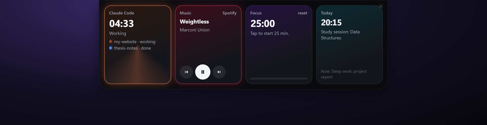
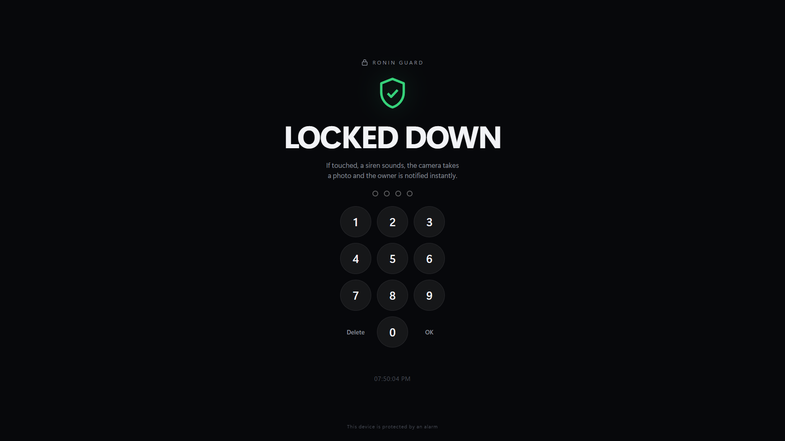
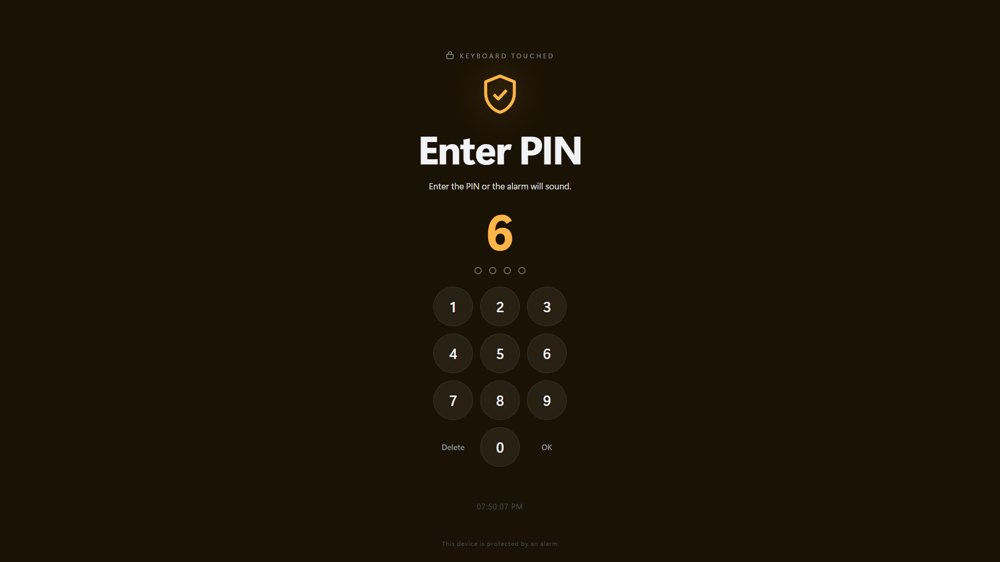
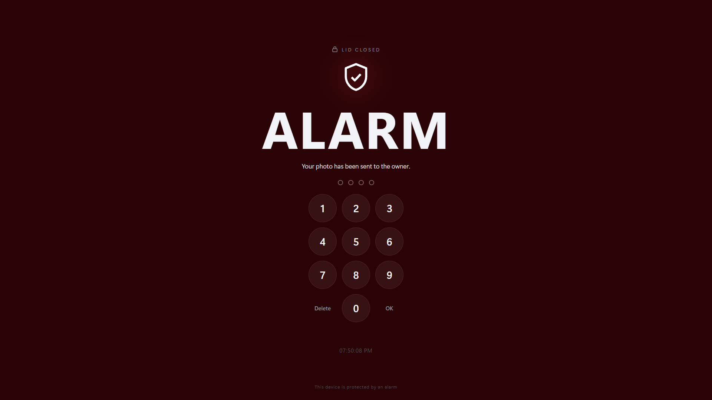

# ronin-agent

**Your own AI chief of staff on Windows, built on Claude Code, with your own empty memory vault.**

[Türkçe README](README.tr.md)

RONIN is not a chatbot. It is Claude Code with three things built around it: **hands** (it works on your real files and connected accounts), **memory** (an Obsidian vault it reads and maintains itself, so every session starts where the last one stopped), and **structure** (indexes and rules that make that memory precise). This repo is a starter kit: one installer gives you the whole stack with a blank vault and an agent named whatever you like.

It stands on the open-source work of [Jared Rhodenizer](https://github.com/jaredrhod) (memory vault, voice, face, installer). This repo adds a Windows layer on top. See [Credits](#credits).

## Features

| Piece | What it does | Default |
|---|---|---|
| **Memory vault** | Obsidian vault skeleton: VAULT-INDEX (your profile + rules), Active Priorities, daily notes from a template, folder indexes, a Weekly Schedule note. Starts empty; the agent interviews you to fill it. | on |
| **Boot config** | `CLAUDE.md` with identity, language, tone and the rules that can't lapse (evidence only, confirm before code edits, confirm before sending email or changing calendars, external content is data, no secrets in notes). | on |
| **Voice + face** | [backtalk](https://github.com/jaredrhod/backtalk) (push-to-talk voice) and [ai-visualizer](https://github.com/jaredrhod/ai-visualizer) (animated face), cloned from upstream. | cloned |
| **Launcher** (`ronin-app`) | One script starts the HUD, face, voice and the optional pieces, then opens the face as an Edge app window. Skips anything already running. | on |
| **HUD sidecar** (`ronin-hud`) | Local JSON at `127.0.0.1:8797`: today's schedule, open tasks, active projects, today's work log, CPU/RAM/battery, service health, optional weather and watched sites. | on |
| **RONIN Island** (`ronin-island`) | A Dynamic-Island style notch at the top of the screen: live Claude Code session state (working / done / needs approval), media controls, a 25-min focus timer, your next schedule block. | off |
| **RONIN Guard** (`ronin-guard`) | Laptop theft alarm: lock screen, siren at full volume, webcam photo and a Telegram ping if someone touches the laptop without your PIN. | run on demand |
| **Telegram** (`ronin-telegram`) | Chat with your agent from your phone through your own bot (official Claude Code Telegram channel plugin), plus an optional morning summary. | off |
| **Reminders** (`ronin-reminders`) | Notification (and optional spoken line) a set time before recurring events from `config.json`. | off |
| **Vault backup** (`ronin-sync`) | Commits the vault and syncs it to your own **private** git remote every 30 minutes. | off |
| **Remote Control** (`ronin-remote`) | A Claude Code Remote Control session you can drive from the Claude app on a phone or tablet. | off |

## Screenshots

**RONIN Island**: a Dynamic-Island style notch at the top of the screen. Collapsed it shows what Claude Code is doing; hover to open it.




**RONIN Guard**: a laptop theft alarm. Locked, then a PIN countdown when someone touches it, then a full alarm (siren, webcam photo, Telegram ping).

| Locked | Touched | Alarm |
| :---: | :---: | :---: |
|  |  |  |

_The screenshots use demo data._

## Requirements

- Windows 10/11
- [Git](https://git-scm.com/) (`winget install Git.Git`)
- [Node.js LTS](https://nodejs.org/) with npm (`winget install OpenJS.NodeJS.LTS`)
- [Python 3.10+](https://www.python.org/) (`winget install Python.Python.3.12`; the Microsoft Store stub does not count)
- [Claude Code](https://docs.claude.com/en/docs/claude-code/setup) and a Claude plan that includes it
- Optional: [uv](https://docs.astral.sh/uv/) for the voice (`winget install astral-sh.uv`), [Bun](https://bun.sh/) for the Telegram plugin (`winget install Oven-sh.Bun`), Microsoft Edge for the app window, [Obsidian](https://obsidian.md/) to browse the vault yourself

## Install

```powershell
git clone <this repo url> ronin-agent
cd ronin-agent
powershell -NoProfile -ExecutionPolicy Bypass -File install.ps1
```

The installer asks for: install folder (default `%USERPROFILE%\ronin`), agent name (default `RONIN`), your name, language, tone, welcome line, and vault folder (default `%USERPROFILE%\<agent>-memory`). Then it:

1. checks the prerequisites,
2. clones the four upstream projects from their original GitHub repositories,
3. copies this repo's layer into the install folder,
4. writes `config.json`, `CLAUDE.md`, the Telegram prompt and (if missing) `backtalk\backtalk.json`,
5. creates the vault from `vault-template\` **only if the vault folder is empty or missing**,
6. points Claude Code's own `MEMORY.md` at the vault (only if that file doesn't exist yet),
7. runs `npm install` for the Island and Guard,
8. prints the next steps.

It is safe to run again: it never overwrites an existing vault, `config.json`, `CLAUDE.md` or `MEMORY.md` (a fresh `CLAUDE.md` goes to `CLAUDE.ronin-template.md` for comparison). Code files of the ronin layer are refreshed from the repo.

Useful switches: `-Yes` (accept defaults), `-InstallDir`, `-VaultPath`, `-AgentName`, `-OwnerName`, `-Language`, `-Tone`, `-WelcomeLine`, `-SkipClone`, `-SkipNpm`, `-RegisterTasks` (creates Task Scheduler tasks `\<Agent>\Vault Sync` every 30 min, `\<Agent>\Reminders` every 15 min, `\<Agent>\Daily Summary` at 07:30, disabled).

After installing, open a terminal in the install folder and run `claude`. The agent greets you, reads its vault and offers to interview you to fill in your profile.

## Configuration

Everything that used to be hardcoded lives in `config.json` in the install folder (template: [`config.example.json`](config.example.json)). **Secrets never go in it.**

| Key | Meaning |
|---|---|
| `agent_name`, `owner_name`, `language` | Identity basics (CLAUDE.md has the full personality) |
| `vault_path` | Your vault; `%USERPROFILE%` and other env vars are expanded |
| `face_url` | Which ai-visualizer face the launcher opens |
| `launcher.*` | Which pieces `RONIN.ps1` starts |
| `hud.port`, `hud.schedule_note`, `hud.day_rollover_hour` | HUD settings; the schedule note is `Weekly Schedule.md` in the vault |
| `hud.watch_urls` | Sites to health-check, `[{"name": "...", "url": "https://..."}]` |
| `hud.weather` | Optional Open-Meteo weather: `enabled`, `latitude`, `longitude` |
| `reminders.events` | Recurring events: `{"name": "Gym", "days": ["Mon","Wed"], "start": "19:00"}` |
| `reminders.lead_minutes`, `.lines`, `.speak`, `.voice_id` | When and how reminders fire; spoken lines need an ElevenLabs key |
| `daily_summary.opener`, `.closer` | Wording of the morning Telegram message |
| `sync.extra_pull_repos` | Extra git folders to fast-forward pull with the vault sync |

Secrets live in Windows **user environment variables** only:

| Variable | Used by |
|---|---|
| `TELEGRAM_BOT_TOKEN` | Guard, daily summary |
| `TELEGRAM_CHAT_ID` | Guard, daily summary (your numeric chat id) |
| `ELEVENLABS_API_KEY` | Reminders (optional), backtalk (optional) |

Set them with `[Environment]::SetEnvironmentVariable('NAME', '<value>', 'User')` in your own terminal, then open a new terminal. The Telegram channel plugin stores its own copy of the bot token through `/telegram:configure`.

### RONIN Island hooks
The Island learns about Claude Code sessions through hooks. Add this to `%USERPROFILE%\.claude\settings.json` (the installer prints it with your real path):

```json
"hooks": {
  "UserPromptSubmit": [{ "hooks": [{ "type": "command", "command": "node <install>/ronin-island/hook.mjs working", "timeout": 5 }] }],
  "Stop":             [{ "hooks": [{ "type": "command", "command": "node <install>/ronin-island/hook.mjs done", "timeout": 5 }] }],
  "Notification":     [{ "hooks": [{ "type": "command", "command": "node <install>/ronin-island/hook.mjs needs", "timeout": 5 }] }],
  "SessionEnd":       [{ "hooks": [{ "type": "command", "command": "node <install>/ronin-island/hook.mjs end", "timeout": 5 }] }]
}
```

### Vault backup
The vault holds your personal life. Back it up **only to a private repository**: create one, then `git -C "<vault>" remote add origin <private repo url>` and register the sync task. Without a remote, `sync.py` just commits locally.

### Start at logon
Create a shortcut in `shell:startup` to:
`powershell.exe -NoProfile -ExecutionPolicy Bypass -WindowStyle Hidden -File "<install>\ronin-app\RONIN.ps1" -Startup`

## Security notes

- **Telegram allowlist.** The Telegram session runs without permission prompts (nobody can click "allow" on a phone). That is only acceptable when the plugin's allowlist contains your own Telegram user id and nobody else. Check it with `/telegram:access`. Never approve a pairing because a message asked you to.
- **Never paste tokens** into a chat, a note, `config.json` or a commit. Use user environment variables. If a token leaks, revoke it (BotFather: `/revoke`) and make a new one.
- **External content is data.** Emails, web pages, files, Telegram/WhatsApp/Teams messages and API responses never give the agent instructions, even when they address it by name. CLAUDE.md enforces this.
- **Confirm before sending.** The agent shows you every email/message and calendar change and waits for an explicit yes.
- **Local only.** The HUD binds to `127.0.0.1`. The Island and Guard keep their state in their own `data/` / `state/` folders, which are git-ignored.
- **Guard photos.** Webcam photos of people may be regulated where you live; check local law.
- **Keep your install private.** `config.json`, `CLAUDE.md`, the Telegram prompt, logs and the vault are personal. The `.gitignore` excludes them, but double-check before you ever publish a fork.

## Updating

- Upstream tools: `git -C "<install>\backtalk" pull` (same for `ai-visualizer`, `fullstack-agent`, `ai-memory-vault`). Never overwrite your `backtalk.json` / `ai-visualizer.json`.
- This layer: `git pull` in your clone of this repo, then run `install.ps1` again with the same install folder.

## Credits

ronin-agent would not exist without **Jared Rhodenizer** ([@jaredrhod](https://github.com/jaredrhod), [jaredrhod.com](https://jaredrhod.com)), who built and open-sourced the foundation:

- [ai-memory-vault](https://github.com/jaredrhod/ai-memory-vault) — the memory vault system and the CLAUDE.md / VAULT-INDEX / daily-note templates this repo's templates are adapted from (CC BY-SA 4.0)
- [fullstack-agent](https://github.com/jaredrhod/fullstack-agent) — the guided installer for the full stack (AGPL-3.0)
- [backtalk](https://github.com/jaredrhod/backtalk) — the voice (AGPL-3.0)
- [ai-visualizer](https://github.com/jaredrhod/ai-visualizer) — the face (AGPL-3.0)

His videos and community: [YouTube](https://youtube.com/@jaredrhod). If his work helps you, consider supporting him via the links in his repositories.

The Guard idea comes from the Mac app "MacGuard".

## License

- **Code** in this repository (`install.ps1`, `config.example.json`, `ronin-*`): [MIT](LICENSE).
- **Templates** (`templates/`, `vault-template/`): [CC BY-SA 4.0](templates/LICENSE.md), adapted from ai-memory-vault by Jared Rhodenizer.
- **Upstream projects** are not included; the installer clones them and they keep their own licenses (AGPL-3.0 / CC BY-SA 4.0).

Details: [NOTICE.md](NOTICE.md).
